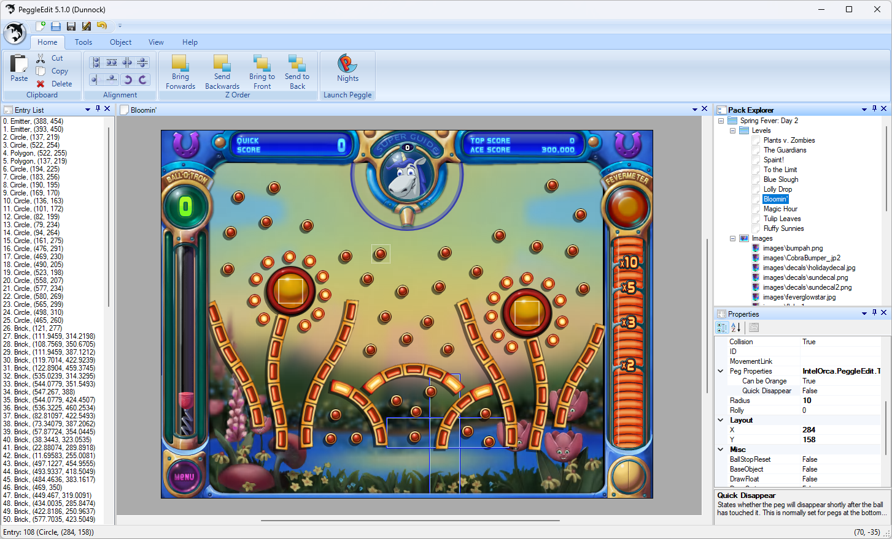

# PeggleEdit
A WYSIWYG level editor for Peggle Nights written in C# / WinForms.

## Quick Start
- Download the peggleedit.zip [here](https://github.com/IntelOrca/PeggleEdit/releases/latest).
- Make a folder, then extract all the files from that zip into the folder
- Open peggleedit.exe and you're good to go!

## Nightly builds
A [nightly build](https://github.com/IntelOrca/PeggleEdit/releases/tag/nightly) is published for every change to master. Nightly builds contain the latest features and fixes but may be unstable. PeggleEdit checks for updates when it starts and offers to update itself; choose the Release or Nightly update ring under Options > Application.

## Documentation
Documentation can be found [here](https://github.com/IntelOrca/PeggleEdit/blob/master/docs/index.md).

## Art Overlay
You can use this [image](docs/img/bg_template.png) to check how your art works. Simply put it into your preferred image editor as a layer and you're good. The resolution of Peggle art is 800x600.

## License
PeggleEdit is licensed under the  GPL-3.0 license.
