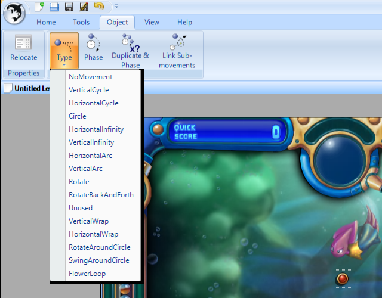
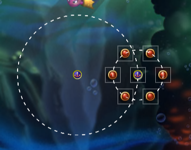
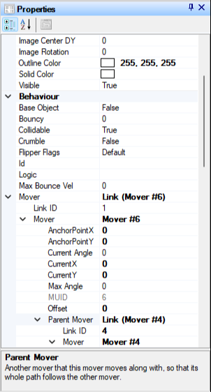

# Movement

Any object can move. Turn on **Preview** on the **View** tab to watch objects move as they will in the game.

## Making an object move
1. Select the object.
2. On the **Object** tab, click **Type** and pick a movement, such as `Circle` or `HorizontalCycle`.
3. In the **Properties** window, open **Mover** to change the movement.

The most useful movement settings are:

| Setting | What it does |
|---|---|
| Type | The shape of the path. |
| Radius, Y Radius | How big the path is across and up and down. Leave Y Radius at 0 to use Radius for both. |
| Time | How long one trip round the path takes, in hundredths of a second (100 is 1 second). Smaller is faster. |
| Reverse | Goes round the path the other way. |
| Phase | Where on the path the object starts, as a fraction of the way round (0.25 is a quarter). |
| Path Rotate | Turns the whole path, in degrees. |
| Max Angle | How far the object swings either side for `RotateBackAndForth` and `SwingAroundCircle`. Unlike other angles, this one is in radians (3.14 is a half turn). 0 means a half turn. |
| Pause 1, Pause 2 | Make the object stop for a while at points on its path, set by Phase 1 and Phase 2. |
| Offset | Starts the object as if it had already been moving for this long. |

The dotted line shows the path, and the anchor shows the centre of it. Turn on **Always show anchors** in **PeggleEdit Options** to see the anchors of every moving object.

## Several objects on one path
To make a ring of pegs that all go round the same path:
1. Give one peg a movement.
2. Click **Duplicate & Phase** on the **Object** tab and say how many pegs you want. Copies are made and spread evenly along the path.

If you already have the objects, give them the same movement, select them all, and click **Phase** to spread them out.

## Advanced movement
An object can move along a path whose centre is also moving. Think of the Moon going round the Earth while the Earth goes round the Sun.

To do this, you make one object that moves (the Earth), and make other objects follow it (the Moon):
1. Place an object where you want the centre of the whole movement. A [ball](Balls.md) works well.
2. Give it a movement, for example a large `Circle`. This is the "outer" movement.
3. If you do not want it to show in the game, turn off its **Visible** and **Collidable** settings.
4. Place the objects that should follow it and give them their own movement, for example a small `Circle`.
5. Click the object from step 1 first. Then hold **Ctrl** and click each of the objects from step 4.
6. Click **Link Sub-movements** on the **Object** tab.

Each object's path now goes around the first object, and moves with it. You can link the first object to another moving object in the same way, to add more layers of movement.

Each link is stored in the object's **Mover**, under **Parent Mover**. PeggleEdit keeps links when you change the drawing order of objects, so you do not need to worry about the numbers the game uses for them.

[Generators](Generators.md) can also move, and other objects can follow them in the same way.
