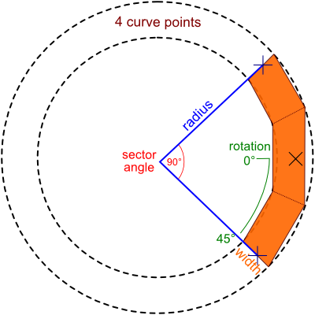

# Bricks

Bricks are pegs that are long and thin. They can be straight or curved, and have the same [peg settings](Pegs.md) as round pegs.

## Placing bricks
* Use the **Brick** tool for straight bricks and the **Curved Brick** tool for curved ones.
* A brick placed near the end of another brick joins on to it neatly. Hold **Shift** to stop it joining.
* With the **Select** tool and one brick selected, point at the end you want to add to. A faint brick shows where the new one will go. Then press:
  * **B** to add a curved brick that carries on the curve.
  * **V** to add a curved brick that bends the other way.
  * **Shift+B** to add a straight brick.
  * Hold **Ctrl** as well to add it even if something is in the way.
* The [Brick Pen and Brick Generator](Generators.md) can place lots of bricks at once.

## Brick settings

| Setting | What it does |
|---|---|
| Type | The shape of the brick, which the game both draws and bounces the ball off. See below. |
| Radius | How big the curve is. For a straight brick, this is its length, which the game keeps to 600 at most. |
| Angle | How much of a circle a curved brick covers, in degrees. A bigger angle makes a longer, more curved brick. |
| Thickness | How thick the brick is. |
| Curve Points | How smooth the curve is. Raise it if a large curved brick looks like it has straight edges. |
| Texture Flip | Which side the shine is on. Keeps the shine the same along a row of bricks. |
| Left Angle, Right Angle | Tilt the ends of a straight brick, in degrees anticlockwise, e.g. to make the corners of a frame meet. With the brick as placed (rotation 90), Left Angle tilts the end on the right and Right Angle the end on the left. Curved bricks do not use them. |

## Brick types

| Type | Shape |
|---|---|
| Normal Curved | Both edges curve. |
| Outer Curved | The outer edge curves and the inner edge is straight. The ends point at the middle of the curve, like a normal curved brick's. |
| Outer Curved 90 | The outer edge curves and the inner edge is straight, with ends that meet it at right angles: a block with a rounded top. |
| Inner Curved | The inner edge curves and the outer edge is straight. |
| Inner Curved 90 | The inner edge curves and the outer edge is straight, with ends that meet it at right angles. |
| Straight | A straight brick, whose length is its **Radius**. |

## How curved bricks work
A curved brick is a slice of a ring. When you hover over a brick, PeggleEdit shows the inside and outside of the ring it is part of.

