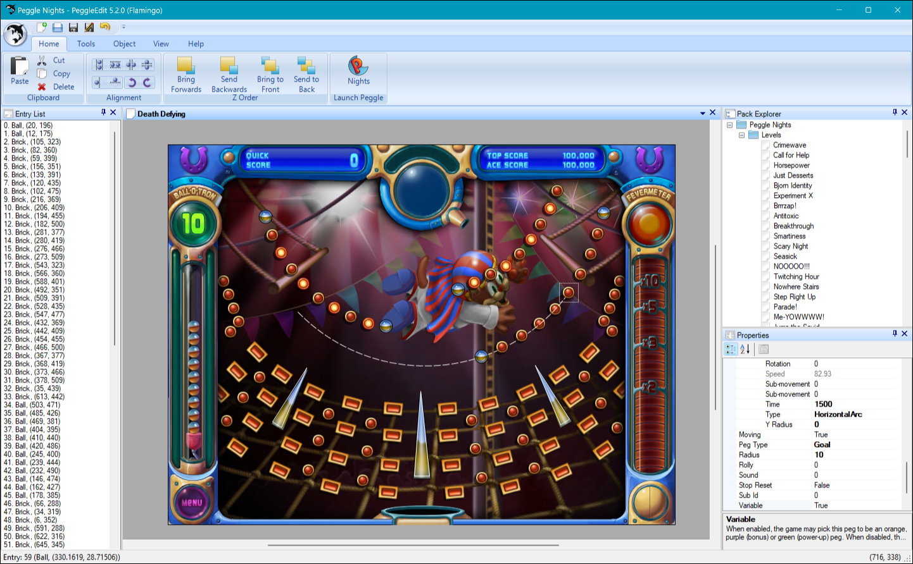

# PeggleEdit

PeggleEdit is a level editor for Peggle Nights. It shows your levels as close as it can to how the game will.

## Using PeggleEdit
* [Getting Started](GettingStarted.md)
* [Editor Guide](EditorGuide.md)
* [Level Packs](LevelPacks.md)
* [Level Objects](LevelEntries.md)
  * [Pegs](Pegs.md)
  * [Bricks](Bricks.md)
  * [Balls](Balls.md)
  * [Polys](Polys.md)
  * [Lines](Lines.md)
  * [Holes](Holes.md)
  * [Emitters](Emitters.md)
  * [Generators](Generators.md)
* [Movement](AdvancedMovement.md)
* [Command Line Tool](CommandLine.md)
* [Frequently Asked Questions](FrequentlyAskedQuestions.md)
* [Planned Features](PlannedFeatures.md)

## For developers
* [Application Design](ApplicationDesign.md)
* [PAK Format](PakFormat.md)
* [Level Format](LevelFormat.md)

## Links
* [Download](https://github.com/IntelOrca/PeggleEdit/releases/latest)
* [What's new](https://github.com/IntelOrca/PeggleEdit/blob/master/CHANGELOG.md)
* [Source code and issues](https://github.com/IntelOrca/PeggleEdit)
